# A7 – FEA on a Bracke

## Objective
Your task is simply to create a high stiff, high strength, and lightweight component. Use Finite Element analysis to drive your decision making process throughout your design. Each step of the analysis and before you make geometric changes make sure the component’s results (stress/displacement/Safety Factor) converge on a 7% difference. Achieve this by modifying the number of elements. If after three attempts to converge use the stiffness and stress from the finer mesh size use the finest mesh size and proceed through the process.

* Use Finite Element Analysis (FEA) to improve the bracket design from previous assignments.
* Ensure high stiffness, strength, and lightweight optimization through iterative design.
* Conduct multiple FEA simulations, refining geometry based on results.
* Perform static stress analysis, including constraints, loading, and meshing selection.
* Interpret data by identifying max stress, displacement, and safety factors.
* Optimize the design by modifying geometry to enhance performance.
* Document the entire process with images, calculations, and insights.
* Reflect on key engineering lessons learned and time spent.

## Analyze

The workflow for the component design has an outer loop and an inner loop. The inner loop’s function  is to validate the results. The outer loop’s function is for the geometry design optimization.

When initially designing my part I used steel (ASTM A36) because the properties are already in SolidWorks and cost is not a constraint. I will continue to use this material for my further analysis.

  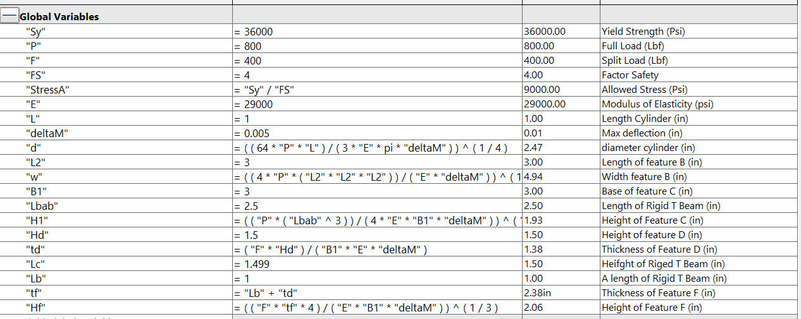

  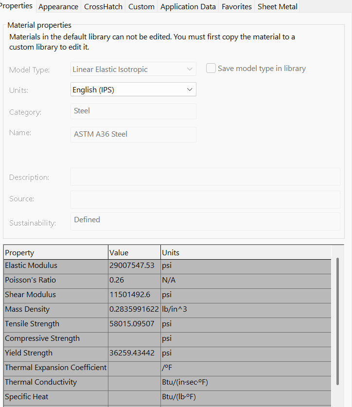

### Iteration Comparison Method
I will be evaluating each iteration of my design with the table below where the first iteration is the original design A5 and A6 assignment.

<table class="design-table">
    <thead>
        <tr>
            <th></th>
            <th>Design 1</th>
            <th>Design II</th>
            <th>Design III</th>
        </tr>
    </thead>
    <tbody>
        <tr>
            <td>Max Stress and location</td>
            <td></td>
            <td></td>
            <td></td>
        </tr>
        <tr>
            <td>Max deflection and location</td>
            <td></td>
            <td></td>
            <td></td>
        </tr>
        <tr>
            <td>mass</td>
            <td></td>
            <td></td>
            <td></td>
        </tr>
        <tr>
            <td>Safety Factor</td>
            <td></td>
            <td></td>
            <td></td>
        </tr>
        <tr>
            <td>Number of elements</td>
            <td></td>
            <td></td>
            <td></td>
        </tr>
    </tbody>
</table>

The known parameters that the design is based off of is

Sy = 36,000 psi

Factor of Safety (FS = 4

P = 800 lbf

&sigma;allow = Sy / FS = 9,000 psi

E = 29,000 psi

&delta;max = 0.005 inches

The modulus of elasticity used for calculation (E) is 29,000 psi while the built in modulus of elasticity for the same material in SolidWorks is 29,007,547.53 psi. I updated the elasticity in the parametric equations after noticing this.

Since the inner loop will stay the same, I am adding fixture to the top of the inner loop where the entire design will be hanging off of.

  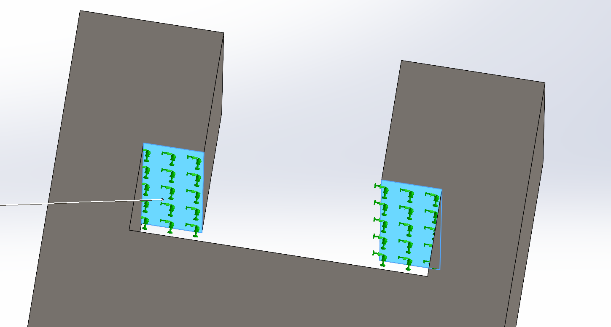

I will also be adding the applied load to the top of the cylinder holder because this is where the load is originating from. The load will be 800 Lbf because that is was the previously chosen load. This will remain constant for each iteration.

  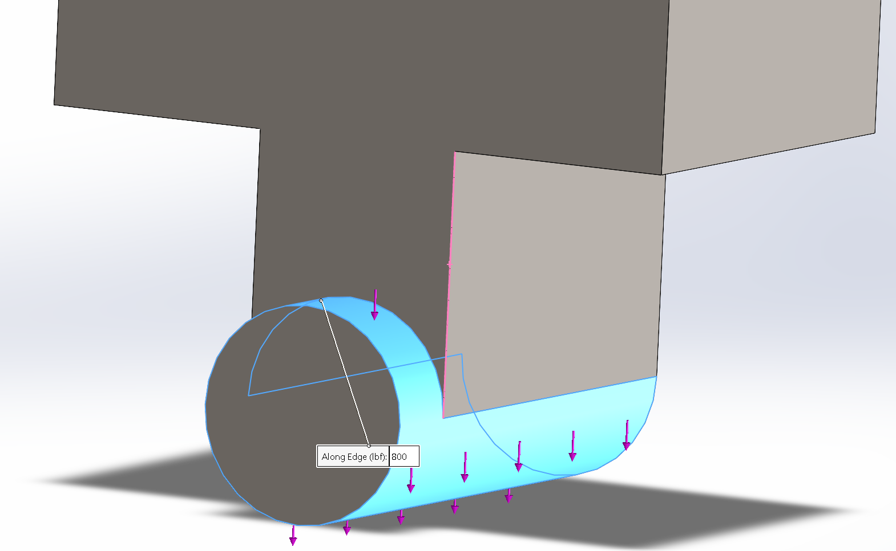

### Mesh Convergence Study Overview
For the first test of the each iteration, I used a the medium mesh density with the blended curvature based mesh. For the second test of the each iteration I used the most course blended curvature based mesh. 

For each design iteration, I will check the reliability of the SolidWorks high-quality, curvature-based mesh by conducting a mesh convergence study. The only variable I will change during this study is the mesh density. I will compare a coarse mesh with a medium-density mesh, keeping the mesh type and all other simulation settings the same for each comparison.

I will calculate the percentage change in maximum stress, maximum resultant displacement, and minimum factor of safety using the formula below:

  <strong>Change (%) = </strong>
  
    
      |Higher Density's Result − Lower Density's Result|
    
    
      |Higher Density's Result|
    
  
  × 100

If my FEA results have not converged after three mesh attempts, the assignment allows me to proceed using the results from the finest mesh, documenting that convergence was not achieved. Convergence is considered within 7%

## Iteration 1

### Medium density mesh

Below is the medium density mesh

  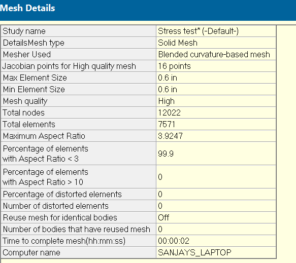

  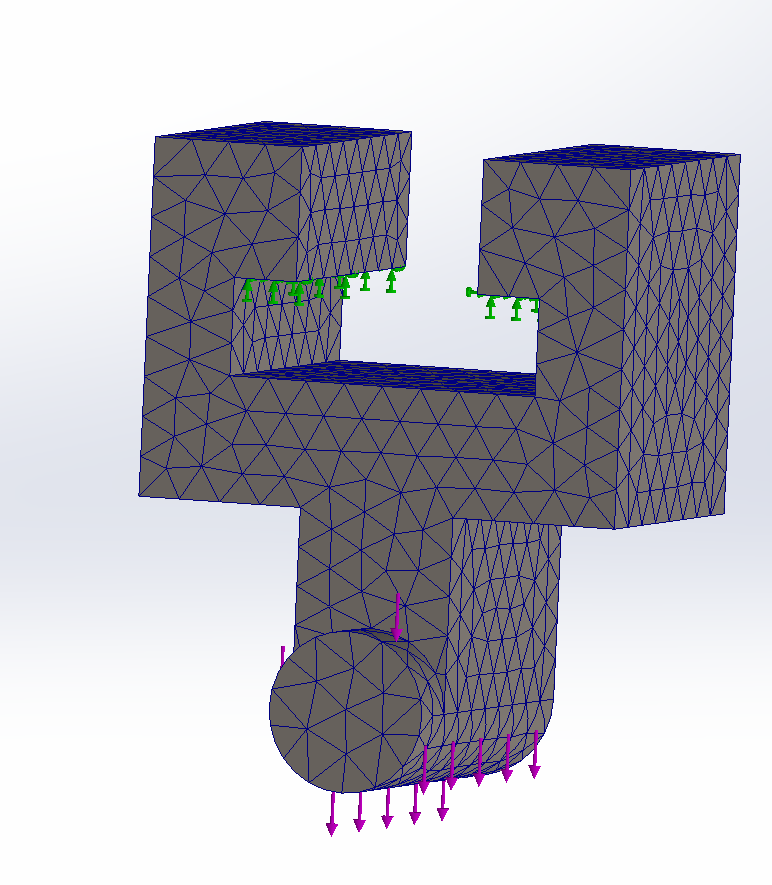

Below is the von Mises stress analysis for the medium density mesh

  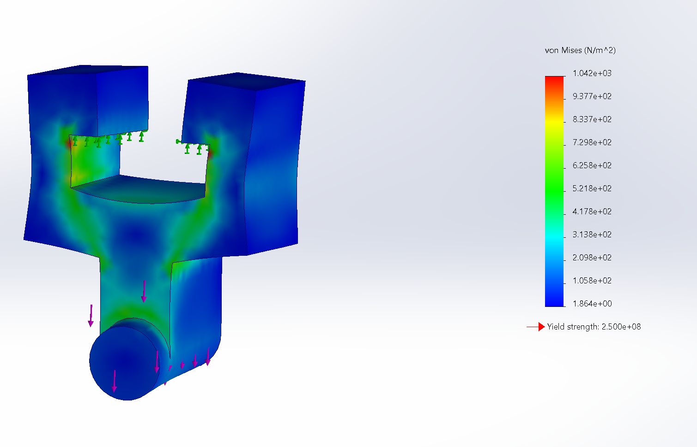

Below is the resultant displacement Simulation

  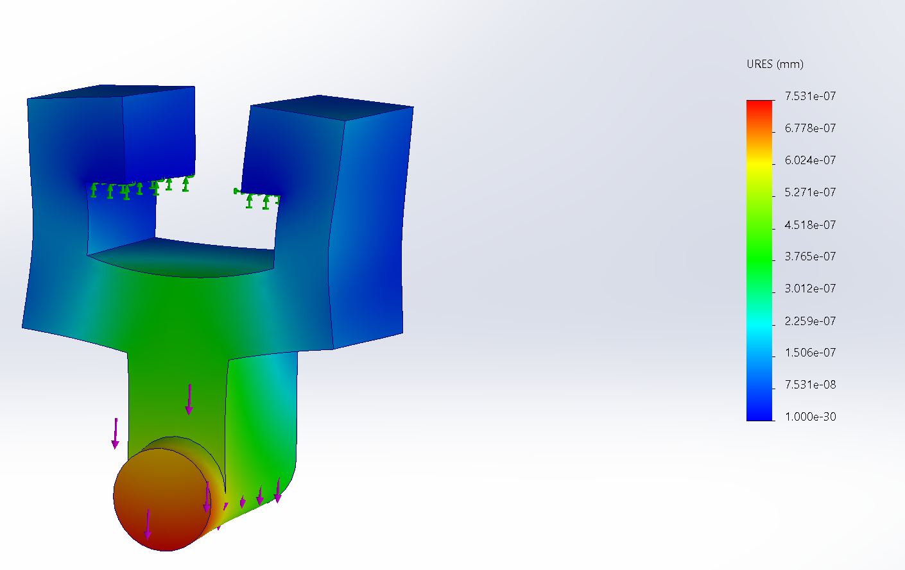

Max von Mises Stress = 1.042 * 10^3 Psi

Yield Strength (Sy) = 2.500 * 10^8 Psi

Minimum Factor of Safety (FS) = (Sy)/(Max vos Mises Stress) = 239,923

Maximum Resultant Displacement = 2.961 * 10^(-7) in

### Course Mesh

Below is the course density mesh

  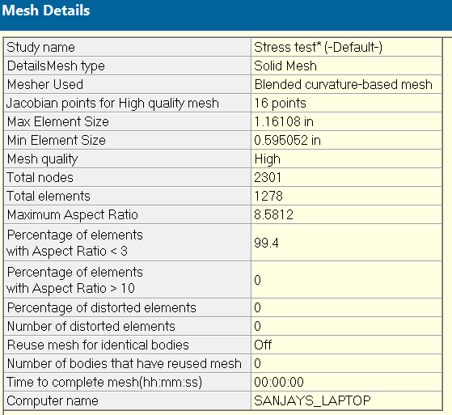

  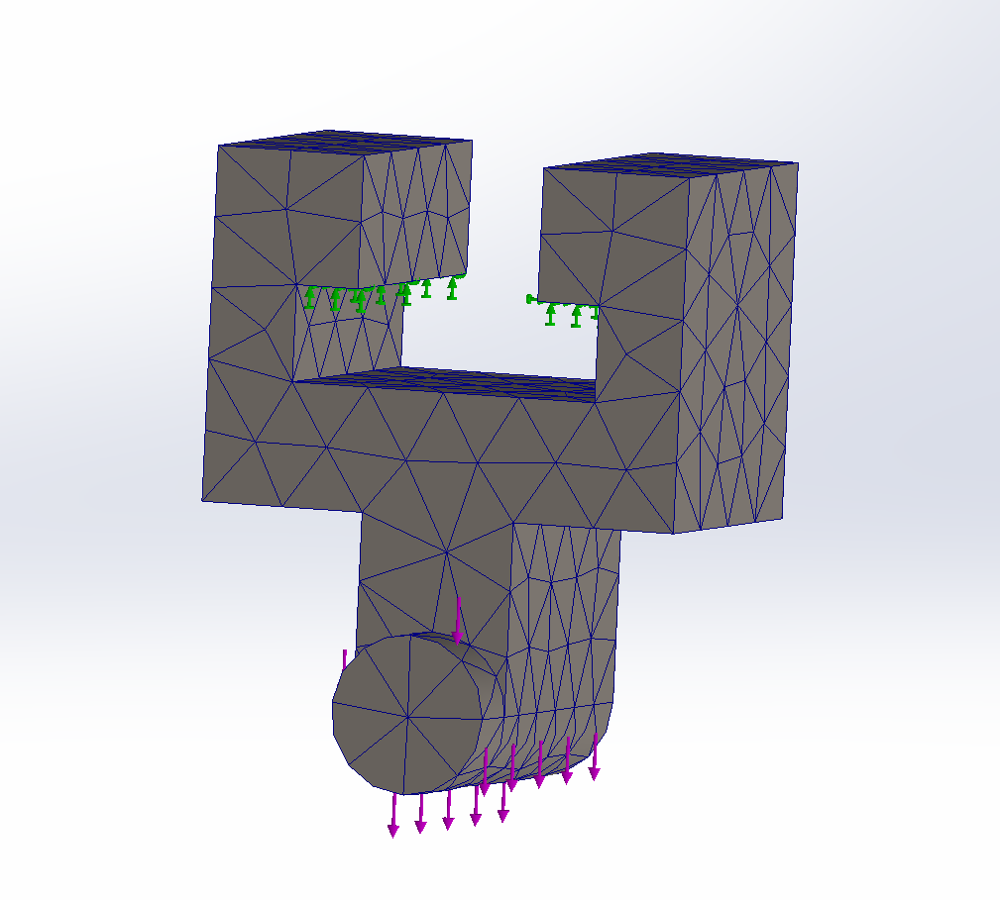

Below is the von Mises stress analysis for the course density mesh

  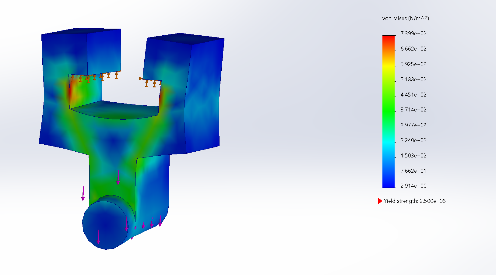

Below is the resultant displacement Simulation

  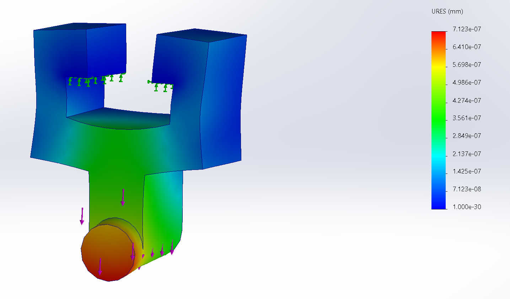

Max von Mises Stress = 7.399 *10^2 Psi

Yield Strength (Sy) = 2.500 * 10^8 Psi

Minimum Factor of Safety (FS) = (Sy)/(Max vos Mises Stress) = 337,884

Maximum Resultant Displacement = 2.804 * 10^(-8) in

### Medium vs. Course Mesh Convergence Study

<table style="width:100%; border-collapse:collapse; text-align:center; font-family:Arial,sans-serif;">
    <thead>
        <tr style="background-color:#f2f2f2;">
            <th style="border:1px solid #999; padding:12px; text-align:left;">Measurement</th>
            <th style="border:1px solid #999; padding:12px;">Medium Density</th>
            <th style="border:1px solid #999; padding:12px;">Coarse Density</th>
            <th style="border:1px solid #999; padding:12px;">Change (%)</th>
        </tr>
    </thead>
    <tbody>
        <tr>
            <td style="border:1px solid #999; padding:12px; text-align:left;">
                Maximum von Mises Stress (Pa)
            </td>
            <td style="border:1px solid #999; padding:12px;">
                1.042 &times; 103
            </td>
            <td style="border:1px solid #999; padding:12px;">
                7.399 &times; 102
            </td>
            <td style="border:1px solid #999; padding:12px;">
                29.20%
            </td>
        </tr>
        <tr>
            <td style="border:1px solid #999; padding:12px; text-align:left;">
                Yield Strength (Pa)
            </td>
            <td style="border:1px solid #999; padding:12px;">
                2.500 &times; 108
            </td>
            <td style="border:1px solid #999; padding:12px;">
                2.500 &times; 108
            </td>
            <td style="border:1px solid #999; padding:12px;">
                N/A
            </td>
        </tr>
        <tr>
            <td style="border:1px solid #999; padding:12px; text-align:left;">
                Minimum Factor of Safety (FS)
            </td>
            <td style="border:1px solid #999; padding:12px;">
                239,923
            </td>
            <td style="border:1px solid #999; padding:12px;">
                337,884
            </td>
            <td style="border:1px solid #999; padding:12px;">
                40.83%
            </td>
        </tr>
        <tr>
            <td style="border:1px solid #999; padding:12px; text-align:left;">
                Maximum Resultant Displacement (in)
            </td>
            <td style="border:1px solid #999; padding:12px;">
                2.961 &times; 10-8
            </td>
            <td style="border:1px solid #999; padding:12px;">
                2.804 &times; 10-8
            </td>
            <td style="border:1px solid #999; padding:12px;">
                5%
            </td>
        </tr>
    </tbody>
</table>

From this I do not believe that the results are not stabilized and I will try a third simulation with the finest density mesh.

### Fine Mesh

Below is the fine density mesh

  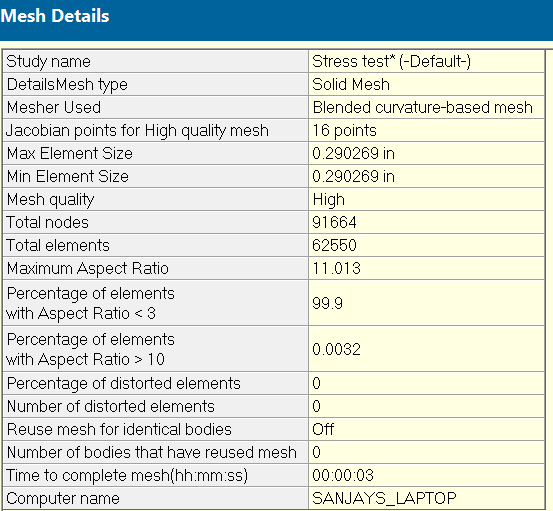

  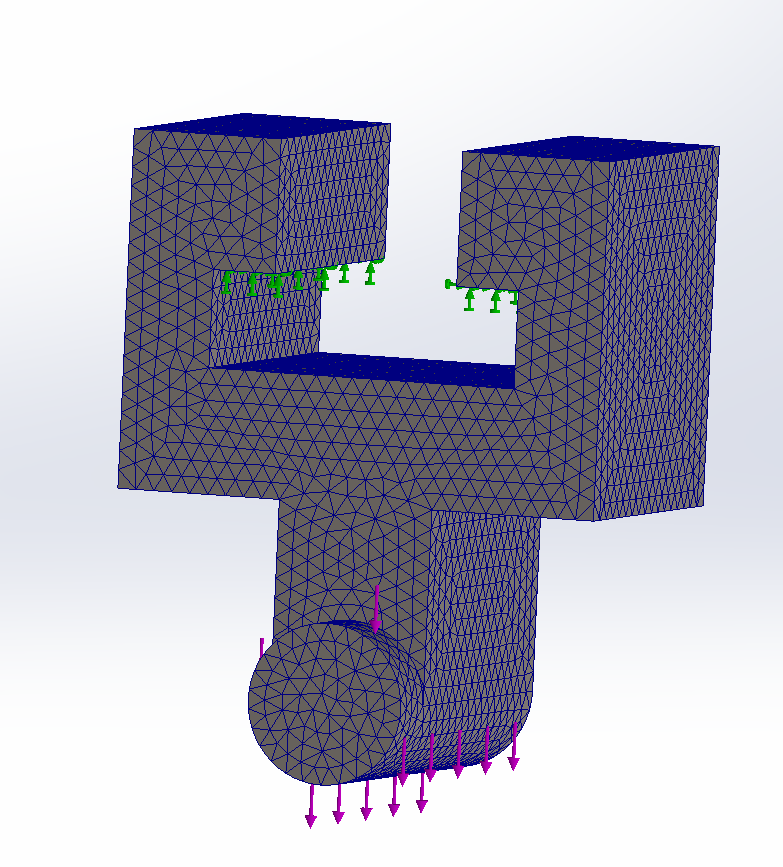

Below is the von Mises stress analysis for the course density mesh

  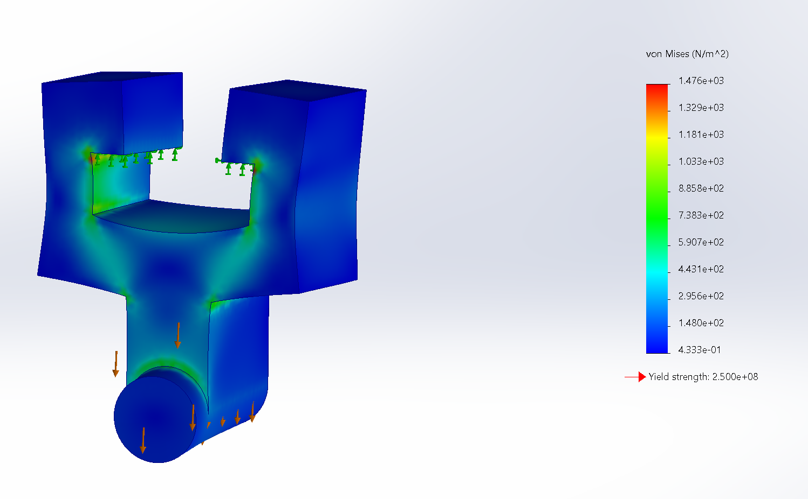

Below is the resultant displacement Simulation

  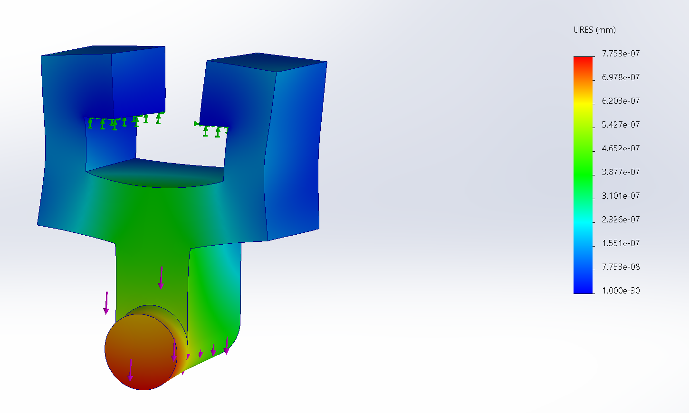

Max von Mises Stress = 1.476 * 10^3 Psi

Yield Strength (Sy) = 2.500 * 10^8 Psi

Minimum Factor of Safety (FS) = (Sy)/(Max vos Mises Stress) = 169,377

Maximum Resultant Displacement = 3.052 * 10^(-8) in

Here is the factor of safety plot with the factor of safety of 4.

### Fine vs. Medium Mesh Convergence Study

<table style="width:100%; border-collapse:collapse; text-align:center; font-family:Arial,sans-serif;">
    <thead>
        <tr style="background-color:#f2f2f2;">
            <th style="border:1px solid #999; padding:12px; text-align:left;">Measurement</th>
            <th style="border:1px solid #999; padding:12px;">Fine Density</th>
            <th style="border:1px solid #999; padding:12px;">Medium Density</th>
            <th style="border:1px solid #999; padding:12px;">Change (%)</th>
        </tr>
    </thead>
    <tbody>
        <tr>
            <td style="border:1px solid #999; padding:12px; text-align:left;">
                Maximum von Mises Stress (Psi)
            </td>
            <td style="border:1px solid #999; padding:12px;">
                1.476 &times; 103
            </td>
            <td style="border:1px solid #999; padding:12px;">
                1.042 &times; 103
            </td>
            <td style="border:1px solid #999; padding:12px;">
                41.65%
            </td>
        </tr>
        <tr>
            <td style="border:1px solid #999; padding:12px; text-align:left;">
                Yield Strength (Sy) (Psi)
            </td>
            <td style="border:1px solid #999; padding:12px;">
                2.500 &times; 108
            </td>
            <td style="border:1px solid #999; padding:12px;">
                2.500 &times; 108
            </td>
            <td style="border:1px solid #999; padding:12px;">
                N/A
            </td>
        </tr>
        <tr>
            <td style="border:1px solid #999; padding:12px; text-align:left;">
                Minimum Factor of Safety (FS)
            </td>
            <td style="border:1px solid #999; padding:12px;">
                169,377
            </td>
            <td style="border:1px solid #999; padding:12px;">
                239,923
            </td>
            <td style="border:1px solid #999; padding:12px;">
                29.40%
            </td>
        </tr>
        <tr>
            <td style="border:1px solid #999; padding:12px; text-align:left;">
                Maximum Resultant Displacement (in)
            </td>
            <td style="border:1px solid #999; padding:12px;">
                3.052 &times; 10-8
            </td>
            <td style="border:1px solid #999; padding:12px;">
                2.961 &times; 10-8
            </td>
            <td style="border:1px solid #999; padding:12px;">
                3.08%
            </td>
        </tr>
    </tbody>
</table>

### Iteration 1 Conclusion

I believe there was such a large factor of safety because I made my design based off of a much lower modulus of elasticity and I made some mistakes on my initial design which were documented on A6. I will go with the results from the finest density simulation because they did not seam to converge.

## Iteration 2
For this design I decided to try and remove material because my factor of safety was much higher than it needed to be. I did this with many fillets and one cut.

Here were the changes I made in order.

  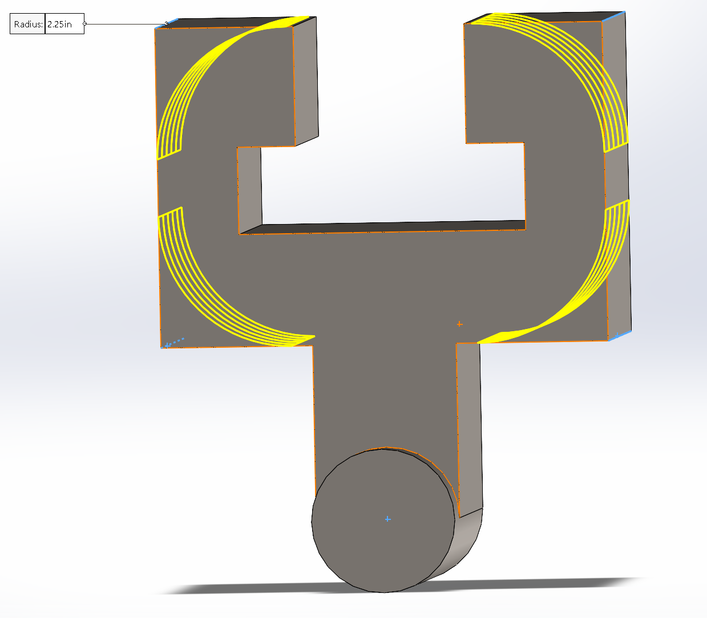

  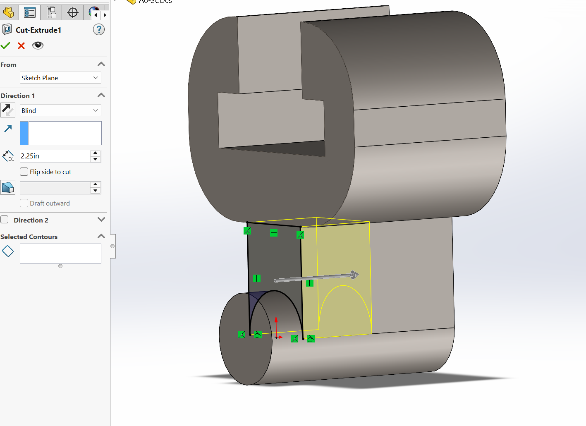

  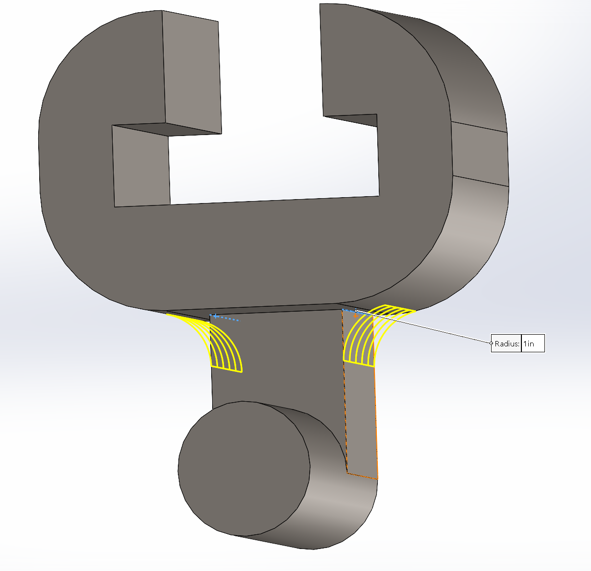

  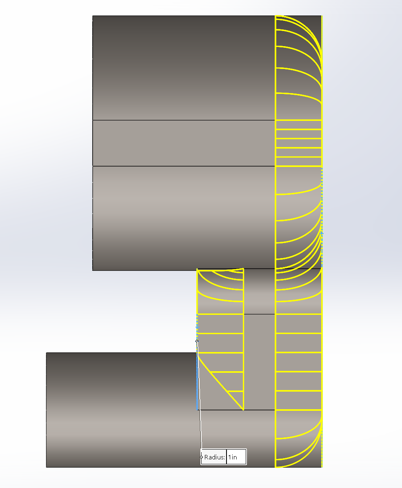

### Medium density mesh

Below is the medium density mesh

  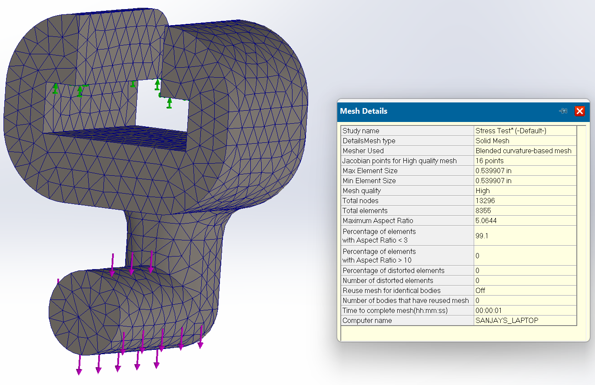

Below is the von Mises Stress analysis for the medium density mesh.

  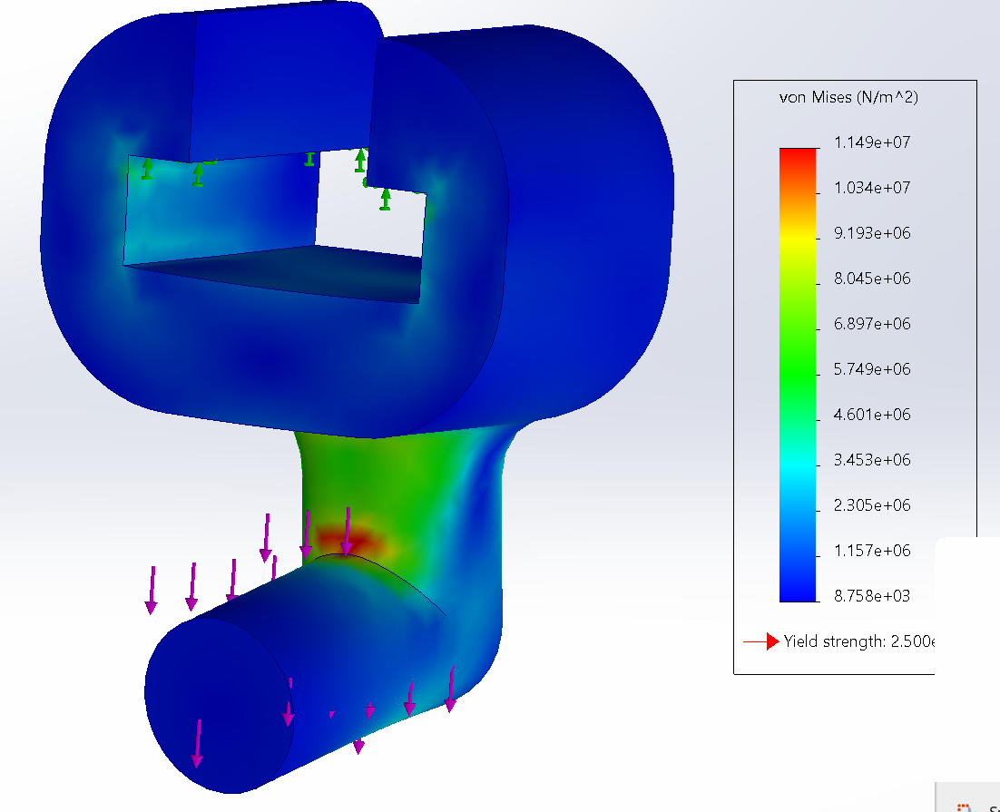

Below is the resultant displacement Simulation

  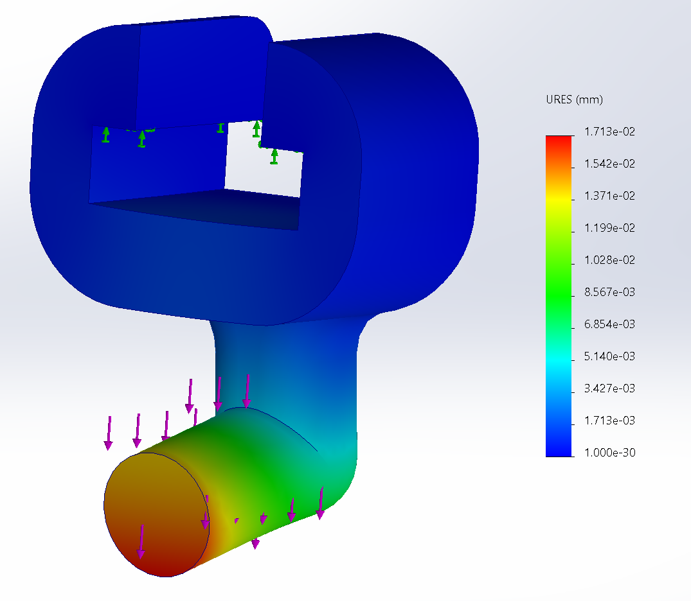

Max von Mises Stress = 1.149*10^7 Psi

Yield Strength (Sy) = 2.500 * 10^8 Psi

Minimum Factor of Safety (FS) = (Sy)/(Max vos Mises Stress) = 21.76

Maximum Resultant Displacement = 4.618 * 10^(-4) in

### Course density mesh

Below is the course density mesh

  

Below is the von Mises Stress analysis for the course density mesh.

  

Below is the resultant displacement Simulation

  

Max von Mises Stress = 9.300 * 10^6 Psi

Yield Strength (Sy) = 2.500 * 10^8 Psi

Minimum Factor of Safety (FS) = (Sy)/(Max vos Mises Stress) = 26.88

Maximum Resultant Displacement = 6.571 * 10^(-4) in

### Medium vs. Course Mesh Convergence Study

<table style="width: 100%; border-collapse: collapse; text-align: center;">
  <thead>
    <tr style="background-color: #f2f2f2;">
      <th style="border: 1px solid #ccc; padding: 10px;">Measurement</th>
      <th style="border: 1px solid #ccc; padding: 10px;">Medium Density</th>
      <th style="border: 1px solid #ccc; padding: 10px;">Coarse Density</th>
      <th style="border: 1px solid #ccc; padding: 10px;">Change (%)</th>
    </tr>
  </thead>
  <tbody>
    <tr>
      <td style="border: 1px solid #ccc; padding: 10px;">Max von Mises Stress (psi)</td>
      <td style="border: 1px solid #ccc; padding: 10px;">1.149 &times; 107</td>
      <td style="border: 1px solid #ccc; padding: 10px;">9.300 &times; 106</td>
      <td style="border: 1px solid #ccc; padding: 10px;">23.55%</td>
    </tr>
    <tr>
      <td style="border: 1px solid #ccc; padding: 10px;">Yield Strength (psi)</td>
      <td style="border: 1px solid #ccc; padding: 10px;">2.500 &times; 108</td>
      <td style="border: 1px solid #ccc; padding: 10px;">2.500 &times; 108</td>
      <td style="border: 1px solid #ccc; padding: 10px;">0%</td>
    </tr>
    <tr>
      <td style="border: 1px solid #ccc; padding: 10px;">Minimum Factor of Safety</td>
      <td style="border: 1px solid #ccc; padding: 10px;">21.76</td>
      <td style="border: 1px solid #ccc; padding: 10px;">26.88</td>
      <td style="border: 1px solid #ccc; padding: 10px;">19.05%</td>
    </tr>
    <tr>
      <td style="border: 1px solid #ccc; padding: 10px;">Maximum Resultant Displacement (in)</td>
      <td style="border: 1px solid #ccc; padding: 10px;">4.618 &times; 10-4</td>
      <td style="border: 1px solid #ccc; padding: 10px;">6.571 &times; 10-4</td>
      <td style="border: 1px solid #ccc; padding: 10px;">29.72%</td>
    </tr>
  </tbody>
</table>

From this I do not believe that the results are not stabilized and I will try a third simulation with the finest density mesh.

### Fine Mesh

Below is the Fine density mesh

  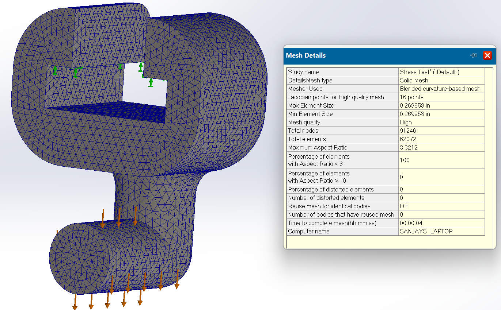

Below is the von Mises Stress analysis for the fine density mesh.

  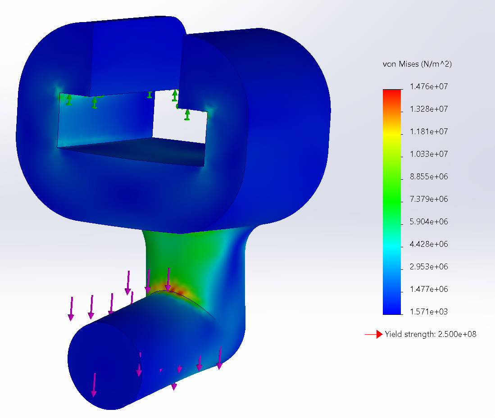

Below is the resultant displacement Simulation

  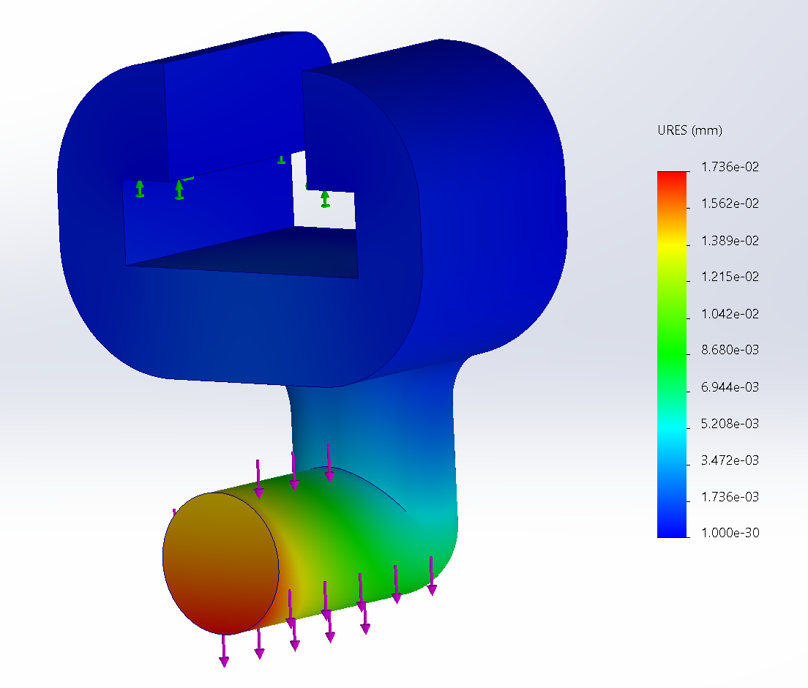

Max von Mises Stress = 1.476 * 10^7 Psi

Yield Strength (Sy) = 2.500 * 10^8 Psi

Minimum Factor of Safety (FS) = (Sy)/(Max vos Mises Stress) = 16.94

Maximum Resultant Displacement = 6.835 * 10^(-4) in

### Fine vs. Medium Mesh Convergence Study

<table style="width: 100%; border-collapse: collapse; text-align: center;">
  <thead>
    <tr style="background-color: #f2f2f2;">
      <th style="border: 1px solid #ccc; padding: 10px;">Measurement</th>
      <th style="border: 1px solid #ccc; padding: 10px;">Fine Density</th>
      <th style="border: 1px solid #ccc; padding: 10px;">Medium Density</th>
      <th style="border: 1px solid #ccc; padding: 10px;">Change (%)</th>
    </tr>
  </thead>
  <tbody>
    <tr>
      <td style="border: 1px solid #ccc; padding: 10px;">Max von Mises Stress (psi)</td>
      <td style="border: 1px solid #ccc; padding: 10px;">1.476 &times; 107</td>
      <td style="border: 1px solid #ccc; padding: 10px;">1.149 &times; 107</td>
      <td style="border: 1px solid #ccc; padding: 10px;">28.46%</td>
    </tr>
    <tr>
      <td style="border: 1px solid #ccc; padding: 10px;">Yield Strength (psi)</td>
      <td style="border: 1px solid #ccc; padding: 10px;">2.500 &times; 108</td>
      <td style="border: 1px solid #ccc; padding: 10px;">2.500 &times; 108</td>
      <td style="border: 1px solid #ccc; padding: 10px;">0%</td>
    </tr>
    <tr>
      <td style="border: 1px solid #ccc; padding: 10px;">Minimum Factor of Safety</td>
      <td style="border: 1px solid #ccc; padding: 10px;">16.94</td>
      <td style="border: 1px solid #ccc; padding: 10px;">21.76</td>
      <td style="border: 1px solid #ccc; padding: 10px;">22.15%</td>
    </tr>
    <tr>
      <td style="border: 1px solid #ccc; padding: 10px;">Maximum Resultant Displacement (in)</td>
      <td style="border: 1px solid #ccc; padding: 10px;">6.835 &times; 10-4</td>
      <td style="border: 1px solid #ccc; padding: 10px;">4.618 &times; 10-4</td>
      <td style="border: 1px solid #ccc; padding: 10px;">48.01%</td>
    </tr>
  </tbody>
</table>

### Iteration 2 conclusion

Iteration 2 is much closer to the safety factor, but still 13-24 away from a safety factor of 4.

## iteration 3
For this iteration, I wanted to make the safety factor slightly lower by cutting even more off and then adding a small web to prevent too much strength from being lost.

  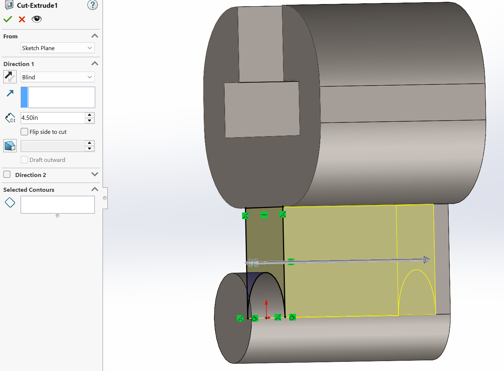

  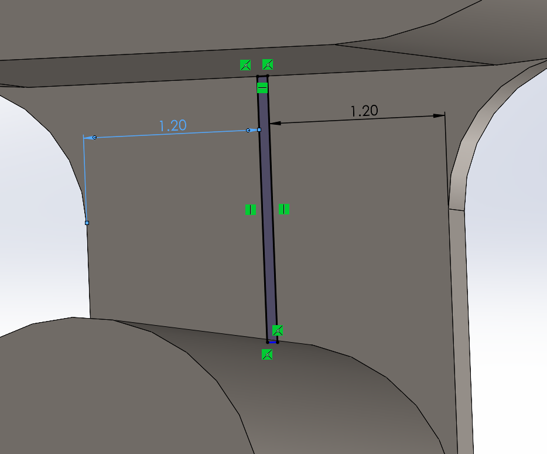

  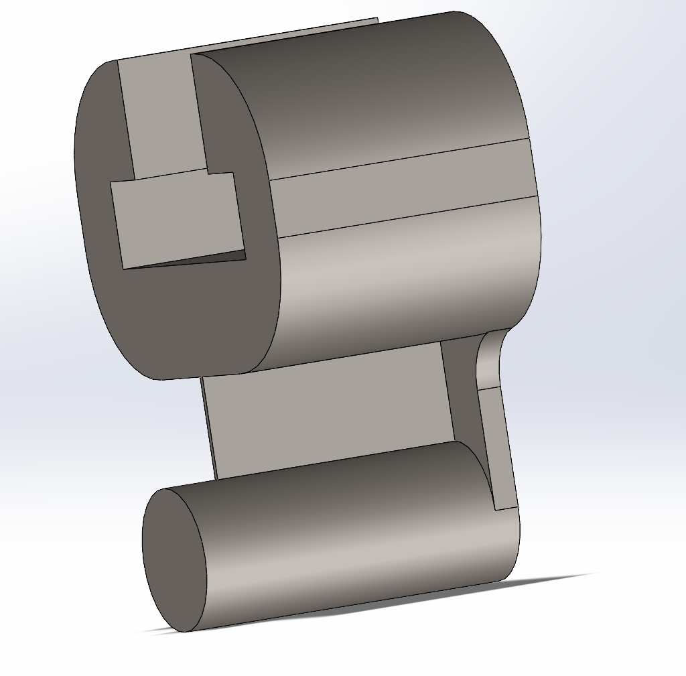

### Medium density mesh

Below is the medium density mesh

  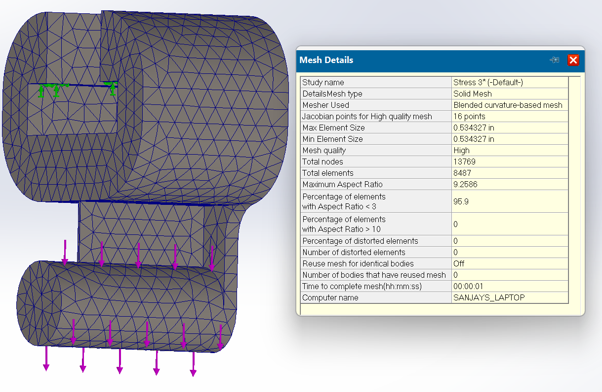

Below is the von Mises Stress analysis for the medium density mesh.

  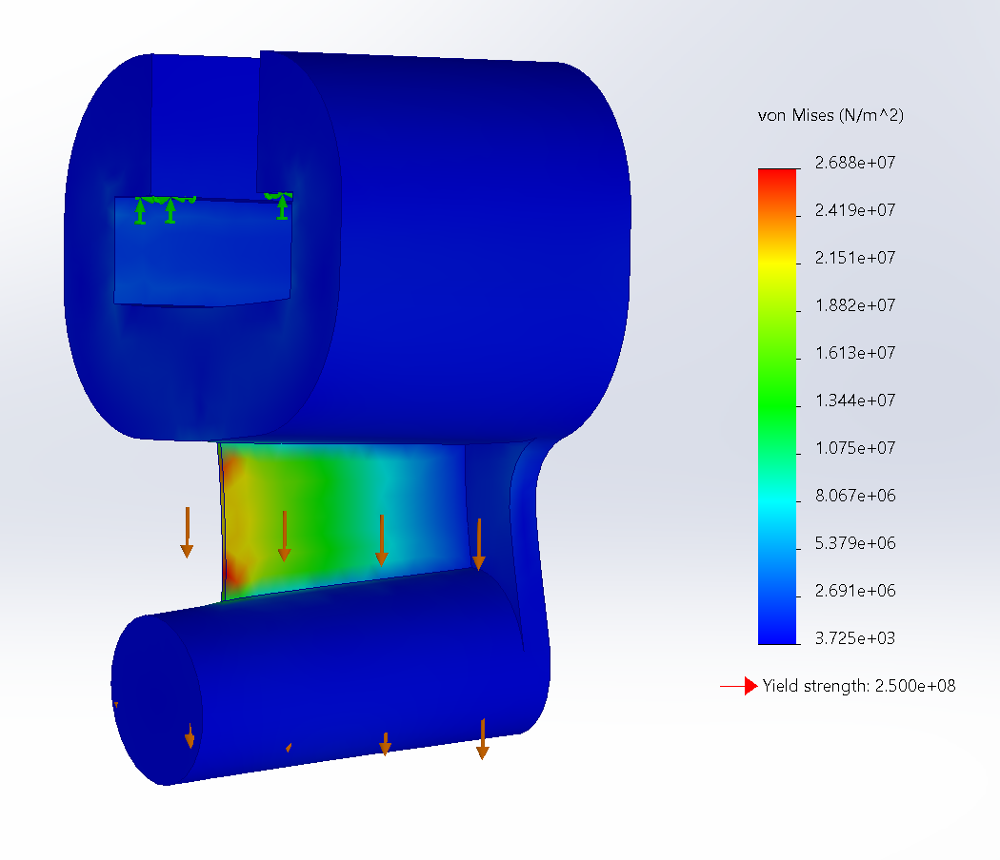

Below is the resultant displacement Simulation

  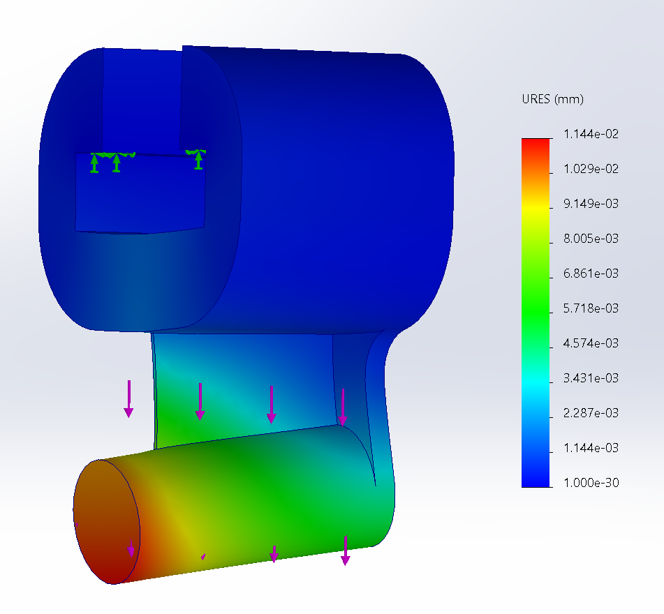

Max von Mises Stress = 2.688 *10^7 Psi

Yield Strength (Sy) = 2.500 * 10^8 Psi

Minimum Factor of Safety (FS) = (Sy)/(Max vos Mises Stress) = 9.30

Maximum Resultant Displacement = 4.504 * 10^(-4) in

### Course density mesh

Below is the course density mesh

  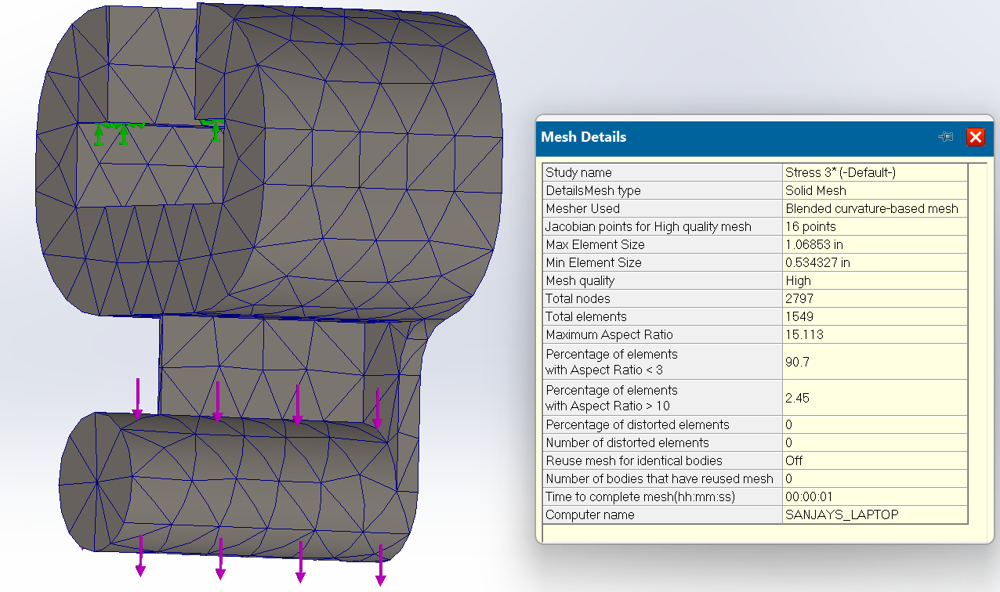

Below is the von Mises Stress analysis for the course density mesh.

  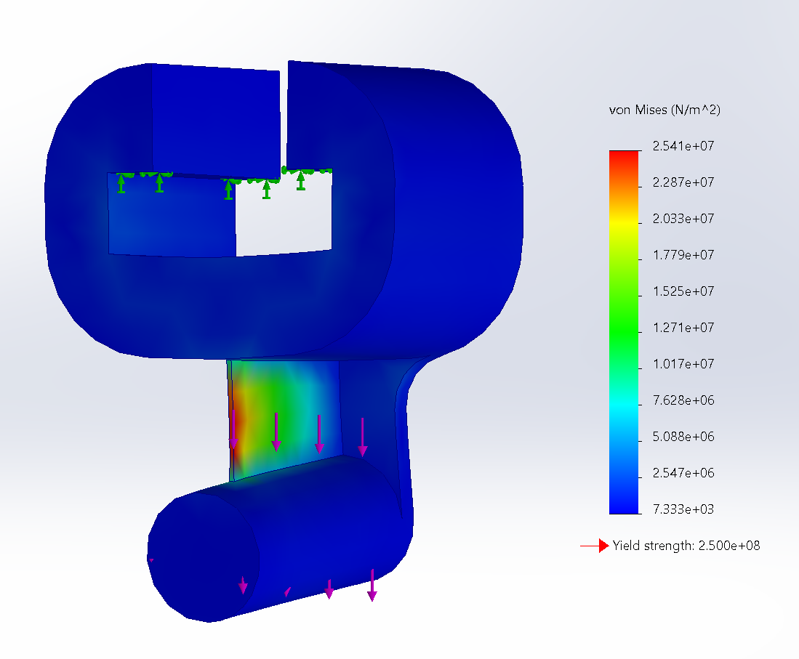

Below is the resultant displacement Simulation

  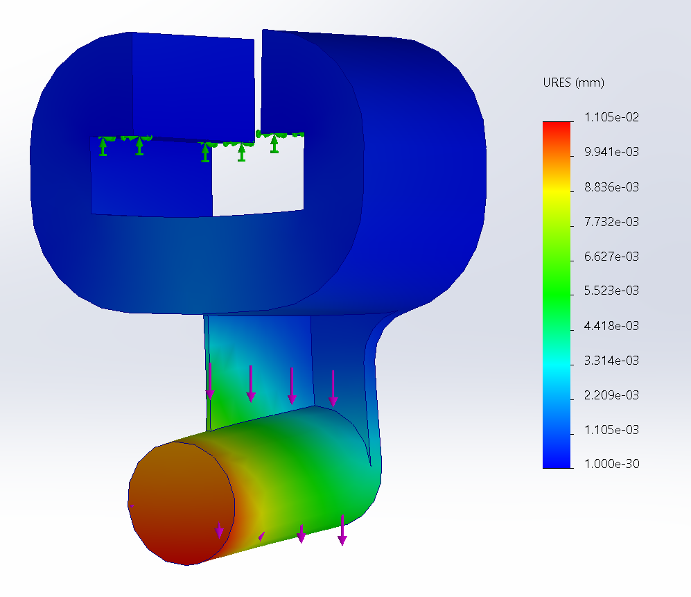

Max von Mises Stress = 2.541 *10^7 Psi

Yield Strength (Sy) = 2.500 * 10^8 Psi

Minimum Factor of Safety (FS) = (Sy)/(Max vos Mises Stress) = 9.84

Maximum Resultant Displacement = 4.350 * 10^(-4) in

### Medium vs. Course Mesh Convergence Study

<table style="width: 100%; border-collapse: collapse; text-align: center;">
  <thead>
    <tr style="background-color: #f2f2f2;">
      <th style="border: 1px solid #ccc; padding: 10px;">Measurement</th>
      <th style="border: 1px solid #ccc; padding: 10px;">Medium Density</th>
      <th style="border: 1px solid #ccc; padding: 10px;">Coarse Density</th>
      <th style="border: 1px solid #ccc; padding: 10px;">Change (%)</th>
    </tr>
  </thead>
  <tbody>
    <tr>
      <td style="border: 1px solid #ccc; padding: 10px;">Max von Mises Stress (psi)</td>
      <td style="border: 1px solid #ccc; padding: 10px;">2.688 &times; 107</td>
      <td style="border: 1px solid #ccc; padding: 10px;">2.541 &times; 107</td>
      <td style="border: 1px solid #ccc; padding: 10px;">5.78%</td>
    </tr>
    <tr>
      <td style="border: 1px solid #ccc; padding: 10px;">Yield Strength (psi)</td>
      <td style="border: 1px solid #ccc; padding: 10px;">2.500 &times; 108</td>
      <td style="border: 1px solid #ccc; padding: 10px;">2.500 &times; 108</td>
      <td style="border: 1px solid #ccc; padding: 10px;">0%</td>
    </tr>
    <tr>
      <td style="border: 1px solid #ccc; padding: 10px;">Minimum Factor of Safety</td>
      <td style="border: 1px solid #ccc; padding: 10px;">9.30</td>
      <td style="border: 1px solid #ccc; padding: 10px;">9.84</td>
      <td style="border: 1px solid #ccc; padding: 10px;">5.49%</td>
    </tr>
    <tr>
      <td style="border: 1px solid #ccc; padding: 10px;">Maximum Resultant Displacement (in)</td>
      <td style="border: 1px solid #ccc; padding: 10px;">4.504 &times; 10-4</td>
      <td style="border: 1px solid #ccc; padding: 10px;">4.350 &times; 10-4</td>
      <td style="border: 1px solid #ccc; padding: 10px;">3.54%</td>
    </tr>
  </tbody>
</table>

This is convergent so I will use the results from the course density FEA test for this itteration.

## Iteration Comparison

<table class="design-table">
    <thead>
        <tr>
            <th></th>
            <th>Design I</th>
            <th>Design II</th>
            <th>Design III</th>
        </tr>
    </thead>
    <tbody>
        <tr>
            <td>Max Stress (psi) and Location</td>
            <td>
                1.476 &times; 103 
                Very slightly below the top two interior corners of the clamp.
            </td>
            <td>
                1.476 &times; 107 
                Corner between the cylinder hanger and the web it hangs from.
            </td>
            <td>
                2.688 &times; 107 
                Halfway up, at the end of the web.
            </td>
        </tr>
        <tr>
            <td>Max Deflection (in) and Location</td>
            <td>
                3.052 &times; 10-8 
                Tip end of cylinder hanger.
            </td>
            <td>
                6.835 &times; 10-4 
                Tip of cylinder hanger.
            </td>
            <td>
                4.350 &times; 10-4 
                Tip end of cylinder hanger.
            </td>
        </tr>
        <tr>
            <td>Mass (lb)</td>
            <td>55.46</td>
            <td>44.61</td>
            <td>43.22</td>
        </tr>
        <tr>
            <td>Safety Factor</td>
            <td>169,377</td>
            <td>16.94</td>
            <td>9.30</td>
        </tr>
        <tr>
            <td>Number of Elements</td>
            <td>62,550</td>
            <td>62,072</td>
            <td>8,487</td>
        </tr>
    </tbody>
</table>

## Communicate

