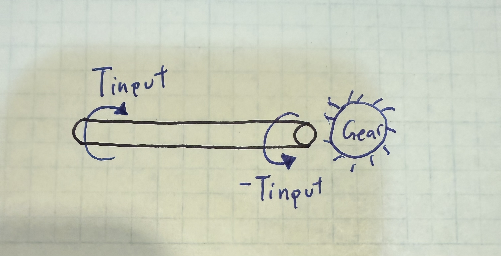
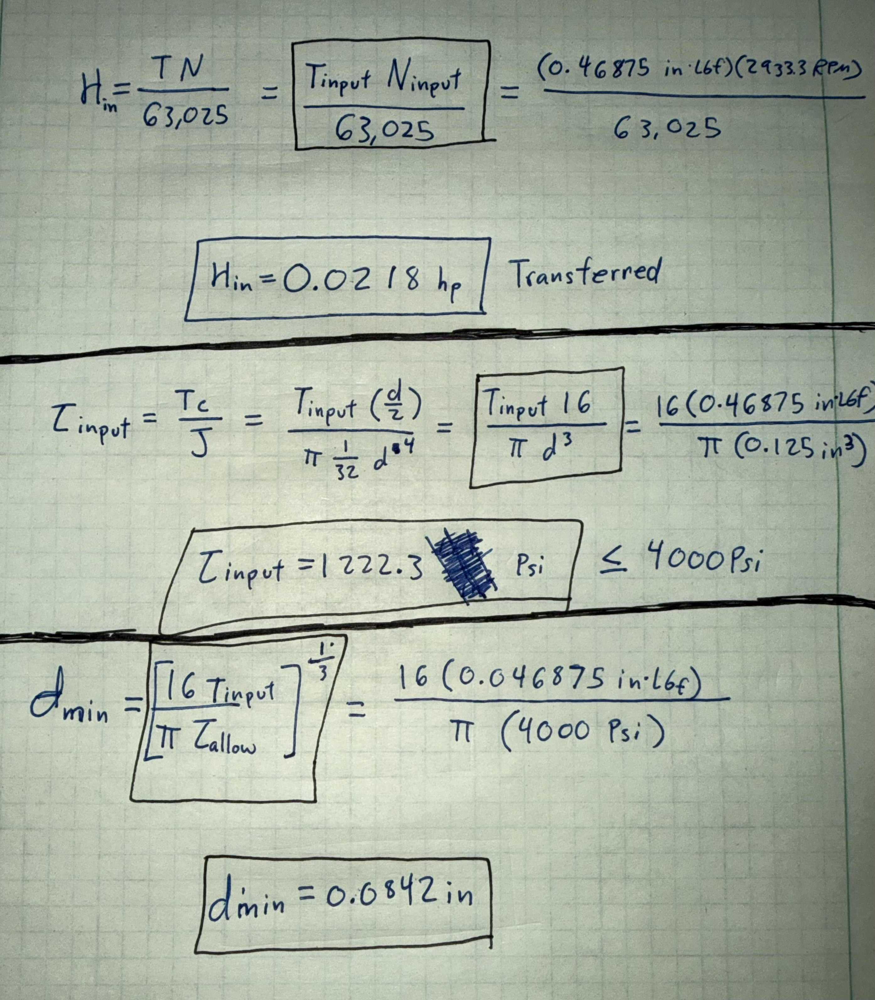
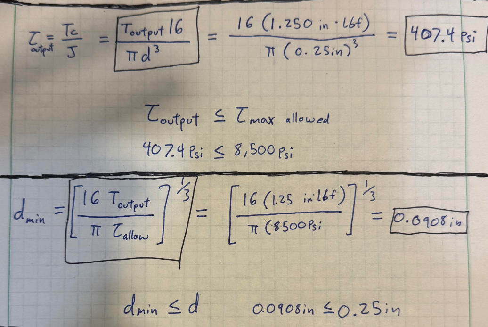

# A8 – Gears

## Objective
Design a gearbox which can be assembled and disassembled. The spur gears have a gear ratio of 24:9 and are listed in the resource section. The output gear torque and speed are to be 1.25 in-lbf and 1100 rpm relative. The input (pinion,power-transmission) and output (gear, short shaft) shaft diameters are .125 and .25 inches respectively and each have a length of 1 inch. Use the appropriate equations in the Machinery’s Handbook for empirical units. The critical features of the gearbox include the shafts, and the journal bearings.

- Design a gearbox that can be assembled and disassembled.
- Analyze and size input and output shafts for strength.
- Design journal bearings to support shafts.
- Create a gearbox housing with proper clearance and fastening.
- Use parametric CAD modeling to generate a final design.
- Document calculations, sketches, and lessons learned.

Noted:
- The shafts are press fit through the hubs of the gears.
- Make sure there is enough clearance between the gears and the gearbox.
- Use a running sliding fit for the size of the hole for the shafts.

## Design

### Knowns and Unknowns

Known:

The gear ratio is 24:9

For the input shaft and gear  

<table border="1" cellpadding="10" cellspacing="0" style="border-collapse: collapse;">
  <tr>
    <td>Number of teeth (z)</td>
    <td>18</td>
  </tr>
  <tr>
    <td>Pitch diameter (D)</td>
    <td>0.375 in</td>
  </tr>
  <tr>
    <td>Shaft diameter (d)</td>
    <td>0.125 in</td>
  </tr>
  <tr>
    <td>Shaft length (L)</td>
    <td>1 in</td>
  </tr>
  <tr>
    <td>Allowable Shear Stress</td>
    <td>4000 psi</td>
  </tr>
  <tr>
    <td>Speed (N)</td>
    <td>To be calculated</td>
  </tr>
  <tr>
    <td>Torque (T)</td>
    <td>To be calculated</td>
  </tr>
</table>

For the output shaft and gear

<table border="1" cellpadding="10" cellspacing="0" style="border-collapse: collapse;">
  <tr>
    <td>Number of teeth (z)</td>
    <td>48</td>
  </tr>
  <tr>
    <td>Pitch diameter (D)</td>
    <td>1 in</td>
  </tr>
  <tr>
    <td>Shaft diameter (d)</td>
    <td>0.25 in</td>
  </tr>
  <tr>
    <td>Shaft length (L)</td>
    <td>1 in</td>
  </tr>
  <tr>
    <td>Allowable Shear Stress</td>
    <td>8500 psi</td>
  </tr>
  <tr>
    <td>Speed (N)</td>
    <td>1100 RPM</td>
  </tr>
  <tr>
    <td>Torque (T)</td>
    <td>1.250 in*lbf</td>
  </tr>
</table>

The allowable shear stresses come from the strengths found in the Machinery Handbook.

### Input Shaft

#### Free Body Diagram

  

#### Calculations

  <b>Ninput = 1100 RPM · (24&frasl;9) = <kbd>2,933.3 RPM</kbd></b>

  <b>Tinput = 1.25 in·lbf · (9&frasl;24) = <kbd>0.46875 in·lbf</kbd></b>

  

The checked shear stress is lower than then maximum allowed shear stress. The minimum required diameter is also less than the used diameter

### Output Shaft

  

  

The checked shear stress is lower than then maximum allowed shear stress. The minimum required diameter is also less than the used diameter

### Gear Design
All the Mac Master spur gears have 20 degree pressure angles

#### Gear and Bearing forces

#### Input Gear

## Communicate

