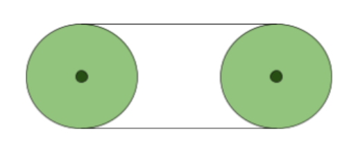
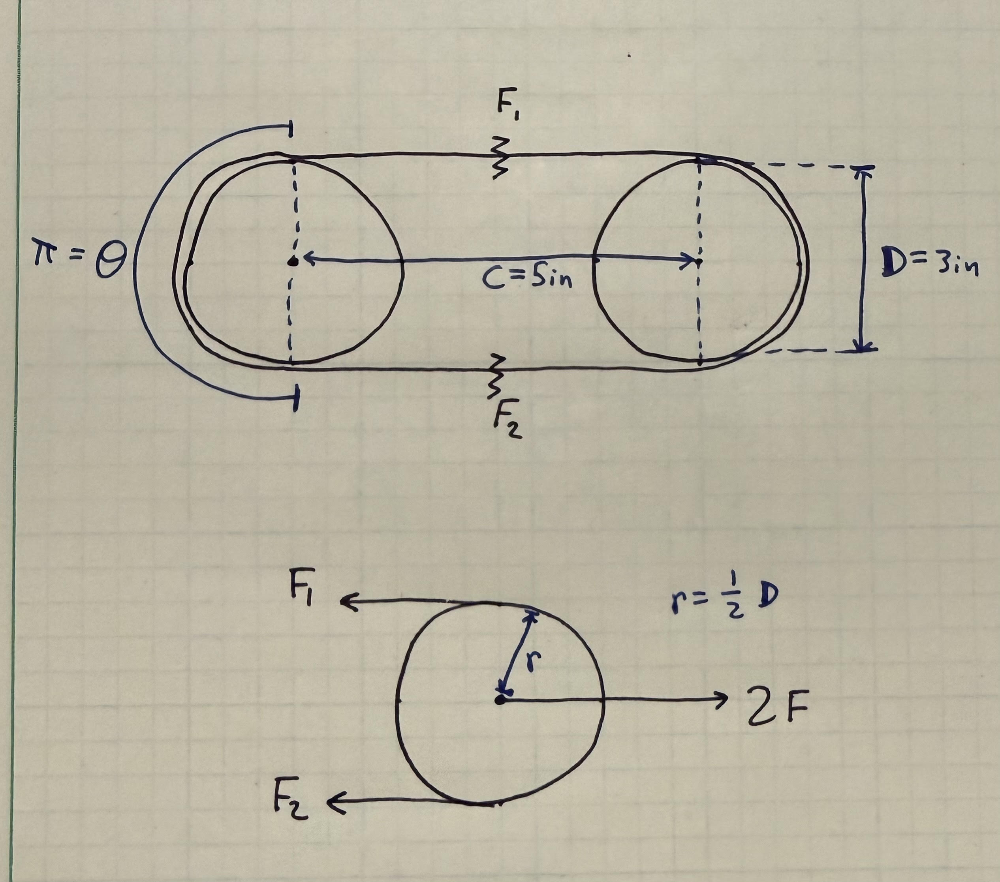
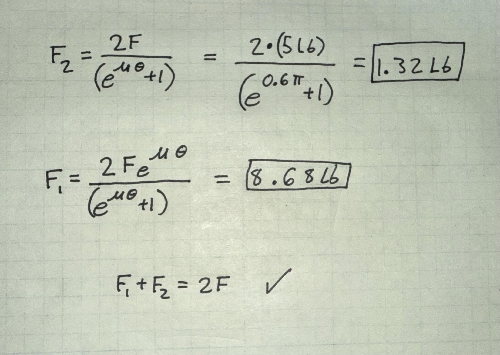
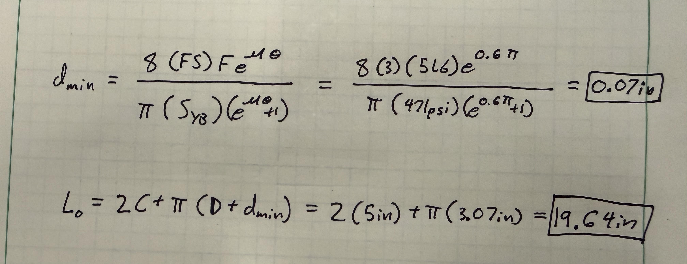

# A9 – Pulleys

## Objective
Design a pulley system to transfer power between two parallel axes separated by a center distance of 4–6 inches. The system must meet the following requirements:

- Pulley Diameter: Both pulleys shall have a diameter of 3 inches.
- Rotational Speed: Select an operating speed between 1000–2000 rpm.
- Belt Tension (Static): Select a belt tension between 4–6 lbf under stationary conditions.
- Material: Pulleys may be made from aluminum, ABS, or steel, and may include a groove and shaft diameter of your choosing (within reasonable manufacturing limits).
- Safety Factor: The design must satisfy a minimum safety factor of 3.
- Assume the belt is made from polyurethane rubber, with a yield strength of 3.25 MPa (471 psi) at 20% strain, based on: Wanga, Chena, Wua, Zhangb, Suna, “Strain-induced Structural and Dynamic Changes in Segmented Polyurethane Elastomers.”

  

## The Knowns

Below I have listed all that is known. When I looked up the coefficient of friction, I found many different coefficients, so I settled with a coefficient of friction of 0.6.

<h3 align="center"><u>Knowns</u></h3>

<table align="center" border="1" cellpadding="10" cellspacing="0">
  <tr>
    <td>Pulley Diameters</td>
    <td>D = 3 in</td>
  </tr>
  <tr>
    <td>Pulley Center Distance</td>
    <td>C = 5 in</td>
  </tr>
  <tr>
    <td>Rotational Speed</td>
    <td>RPM = 1500 rpm</td>
  </tr>
  <tr>
    <td>Stationary Belt Tension</td>
    <td>F = 5 lbf</td>
  </tr>
  <tr>
    <td>Angle of Wrap</td>
    <td>&theta; = 180&deg; = &pi; radians</td>
  </tr>
  <tr>
    <td>Coefficient of Friction</td>
    <td>&mu; = 0.6</td>
  </tr>
  <tr>
    <td>Belt Yield Strength</td>
    <td>Syb = 471 psi</td>
  </tr>
  <tr>
    <td>Safety Factor</td>
    <td>FS = 3</td>
  </tr>
  <tr>
    <td>Pulley Material</td>
    <td>SAE 1060 steel</td>
  </tr>
  <tr>
    <td>Shaft Material</td>
    <td>SAE 1060 steel in the quenched and tempered (Q&amp;T) condition</td>
  </tr>
  <tr>
    <td>Shaft Yield Strength</td>
    <td>Sys = 111,000 psi</td>
  </tr>
  <tr>
    <td>Belt Material</td>
    <td>Polyurethane Rubber</td>
  </tr>
</table>

## Designing the Belt

Below I have listed all that is unknown after completing a free body diagram.

### Free Body Diagram

  

### Unknowns
<h3 align="center"><u>Unknowns</u></h3>

<table align="center" border="1" cellpadding="10" cellspacing="0">
  <tr>
    <td>Tight Side Belt Tension</td>
    <td>F1</td>
  </tr>
  <tr>
    <td>Loose Side Belt Tension</td>
    <td>F2</td>
  </tr>
  <tr>
    <td>Minimum Round Belt Diameter</td>
    <td>dmin</td>
  </tr>
  <tr>
    <td>Belt Outer Circumference</td>
    <td>Lo</td>
  </tr>
</table>

### Solving for Forces
<h3 align="center"><u>Symbolic Solution</u></h3>

  &Sigma;Fx = 0 = 2F &minus; F1 &minus; F2 &rArr; F1 + F2 = 2F

  F1 / F2 = e&mu;&theta; &rArr; F1 = F2e&mu;&theta;

  2F = F2e&mu;&theta; + F2 = F2(e&mu;&theta; + 1)

  <kbd>F2 = 2F / (e&mu;&theta; + 1)</kbd>
  &nbsp;&nbsp;&nbsp;
  <kbd>F1 = 2Fe&mu;&theta; / (e&mu;&theta; + 1)</kbd>

  Amin = &pi;dmin2 / 4

  dmin = &radic;(4Amin / &pi;)

  &sigma;max = F1 / Amin = Syb / FS &rArr; Amin = (FS)F1 / Syb

  Amin = 2(FS)Fe&mu;&theta; / [Syb(e&mu;&theta; + 1)]

  <kbd>dmin = &radic;(8(FS)Fe&mu;&theta; / [&pi;Syb(e&mu;&theta; + 1)])</kbd>

  Lo = 2C + &pi;(D + dmin)

Below I have plugged in the values for the algebraic solutions I have found. I also wrote out the algebraic solution to the problem to avoid any confusion with my final answers. I also verified that calculated force was sensible. 

  

F1 = 1.32 Lb

F2 = 8.68 Lb

  

L = 19.64 inches

### Belt Selection

Now that I have found the necessary length of the belt, I can search for what I want on the McMaster-Carr. I knew that I would not be able to find a perfect 19.64 inch belt, so I searched for a 20 inch belt. The closest I could find was a 1/4 inch diameter Polyurethane belth that is 20 inches long. "5727N62_Static-Control Round Belt" is the name of the product.

  

## Designing the Shaft

## Decide

## Communicate

