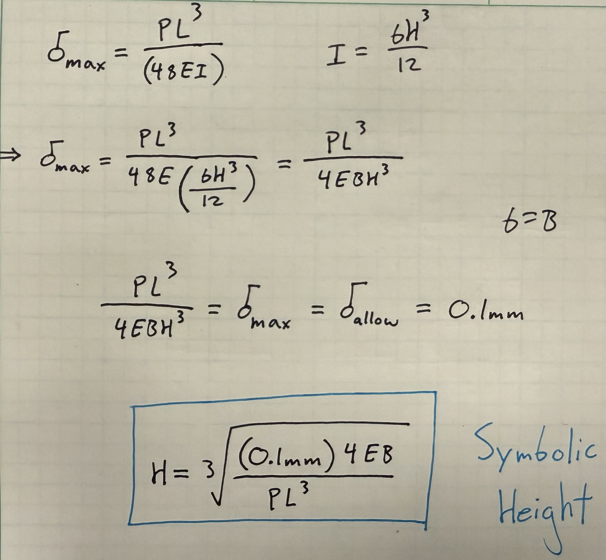

# A10 – Lead Screw Translating System

## Objective

A tensile tester is a mechanical testing device used to measure how materials respond to uniaxial tension. It applies a controlled pulling force to a specimen while recording the resulting elongation, allowing engineers to determine properties such as yield strength, ultimate tensile strength, and elongation at break. This data is essential for understanding a material’s mechanical behavior and suitability for design applications.

  

Design and build a mechanically driven tensile tester capable of applying up to 2 kN axial tensile load with a controllable crosshead speed from 1 to 50 mm/min. Each team is responsible for the mechanical components outlined below. The system will provide consistent, well-aligned loading for polymers and light metals, suitable for instructional use and basic materials evaluation.

## Leadscrew Diameter

## Designing Nut and Flange (Saeed Malik)

### Starting Selection (Sanjay Kashyap)

 My teammate's lead screw selection is:
- Thread type: Acme
- Nominal diameter: 3/8 in
- Thread: 8 TPI
- Lead: 0.125 in/rev
- Two identical lead screws
- Maximum tensile load: 2,000 N
- Safety factor: 4

I have chosen Bronze Nut: 95072A124
 https://www.mcmaster.com/products/lead-screw-nuts/thread-size~3-8-8/

Below are the specifications of Bronze Nut: 95072A124
- 673 bronze
- 3/8"-8 Stub Acme
- Single start, 0.125" lead
- 5/8" nut length
- 9/16"-18 external thread

 I have chosen Flange: 95082A641
 https://www.mcmaster.com/products/nuts/thread-size~3-8-8/

Below are the specifications of Flange: 95082A641
- 9/16"-18 internal thread
- 1 39/64" outside diameter
- 13/32" thickness

## Designing the Crosshead

### Known and Unknown

I chose the center of center distance of 9 because half the 18 in screw length, which is likely what the example team did. It clears grips, specimen and load cell, and a short span keeps deflection low. I chose a width of 2 inches because it fits a typical 3/8-8 bronze flange nut. Check the datasheet of the nut you pick and widen it if the flange is larger. I chose the material 6061-T6 aluminum because it is inexpensive.

<h2>Known Parameters</h2>

<ul>
  <li>
    <strong>Maximum Crosshead Deflection:</strong>
    &delta; = 0.1 mm
  </li>
  <li>
    <strong>Factor of Safety:</strong>
    FS = 4
  </li>
  <li>
    <strong>Center-to-Center Distance Between Screws:</strong>
    L = 9 in (228.6 mm)
  </li>
  <li>
    <strong>Flange Width:</strong>
    b = 2 in (50.8 mm)
  </li>
  <li>
    <strong>Total Length:</strong>
    Ltotal &approx; 10 in
  </li>
  <li>
    <strong>Modulus of Elasticity:</strong>
    E = 68.9 GPa
  </li>
  <li>
    <strong>Yield Strength:</strong>
    Sy = 276 MPa
  </li>
  <li>
    <strong>Applied Load:</strong>
    P = 2000 N
  </li>
  <li>
    <strong>Allowable Stress:</strong>
    &sigma;allow =
    Sy / FS =
    276 MPa / 4 =
    <strong>69 MPa</strong>
  </li>
</ul>

<h2>Unknown Parameters</h2>

<ul>
  <li>
    <strong>Crosshead Height:</strong>
    H
  </li>
  <li>
    <strong>Axial Stress:</strong>
    &sigma;axial
  </li>
  <li>
    <strong>Bending Stress:</strong>
    &sigma;bending
  </li>
</ul>

### Free Body Diagram

Below is a free body diagram of the flange. The dashed lines represent where the lead screw sits.

  

### Strength Analysis of Flange Height

Below are my calculations for the minimum height of the flange based off of the maximum stress allowed. The crosshead is loaded transversely, so the bending stress governs. Axial stress is negligible and is carried by the lead screws (See the lead screw diameter analysis). During these calculations I accidentally switched from using a lowercase "b" to capital "B" however they both represent the flange width.

  

### Deflection Analysis of Flange Height

Below are my calculations for the minimum height of the flange based off of the maximum deflection allowed. During these calculations I accidentally switched from using a lowercase "b" to capital "B" however they both represent the flange width.

  

### Final Height Decision

The minimum height required based on deflection was higher than minimum height required by stress, meaning the height calculated from deflection will be the height used. 

H = 1.02 in

## Tabulating the Costs

## Decide
_Reference your concept selection (Pugh matrix) here. How does this design follow from that decision?_

## Communicate

