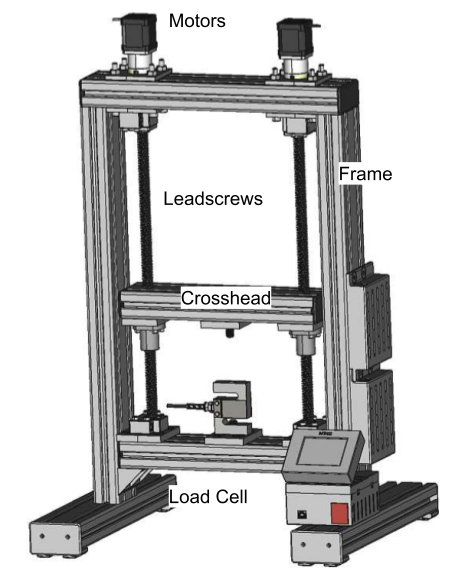

# A10 – Lead Screw Translating System

## Objective

A tensile tester is a mechanical testing device used to measure how materials respond to uniaxial tension. It applies a controlled pulling force to a specimen while recording the resulting elongation, allowing engineers to determine properties such as yield strength, ultimate tensile strength, and elongation at break. This data is essential for understanding a material’s mechanical behavior and suitability for design applications.

  

Design and build a mechanically driven tensile tester capable of applying up to 2 kN axial tensile load with a controllable crosshead speed from 1 to 50 mm/min. Each team is responsible for the mechanical components outlined below. The system will provide consistent, well-aligned loading for polymers and light metals, suitable for instructional use and basic materials evaluation.

## Analyze

## Decide
_Reference your concept selection (Pugh matrix) here. How does this design follow from that decision?_

## Communicate

