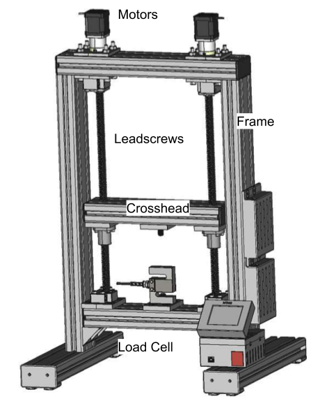

# A10 – Lead Screw Translating System

## Objective

A tensile tester is a mechanical testing device used to measure how materials respond to uniaxial tension. It applies a controlled pulling force to a specimen while recording the resulting elongation, allowing engineers to determine properties such as yield strength, ultimate tensile strength, and elongation at break. This data is essential for understanding a material’s mechanical behavior and suitability for design applications.

  

Design and build a mechanically driven tensile tester capable of applying up to 2 kN axial tensile load with a controllable crosshead speed from 1 to 50 mm/min. Each team is responsible for the mechanical components outlined below. The system will provide consistent, well-aligned loading for polymers and light metals, suitable for instructional use and basic materials evaluation.

## Leadscrew Diameter

## Designing Nut and Flange - Sanjay Kashyap

### Starting Selection

 My teammate's lead screw selection is:
- Thread type: Acme
- Nominal diameter: 3/8 in
- Thread: 8 TPI
- Lead: 0.125 in/rev
- Two identical lead screws
- Maximum tensile load: 2,000 N
- Safety factor: 4

I have chosen Bronze Nut: 95072A124
 https://www.mcmaster.com/products/lead-screw-nuts/thread-size~3-8-8/

Below are the specifications of Bronze Nut: 95072A124
- 673 bronze
- 3/8"-8 Stub Acme
- Single start, 0.125" lead
- 5/8" nut length
- 9/16"-18 external thread

 I have chosen Flange: 95082A641
 https://www.mcmaster.com/products/nuts/thread-size~3-8-8/

Below are the specifications of Flange: 95082A641
- 9/16"-18 internal thread
- 1 39/64" outside diameter
- 13/32" thickness

### Internal Thread Bending Analysis

#### Known and Unknown

<h3>Knowns and Unknowns</h3>

<table>
  <thead>
    <tr>
      <th>Parameter</th>
      <th>Symbol</th>
      <th>Value</th>
    </tr>
  </thead>
  <tbody>
    <tr>
      <td>Total Applied Load</td>
      <td>W</td>
      <td>2,000 N</td>
    </tr>
    <tr>
      <td>Number of Lead Screws</td>
      <td>n</td>
      <td>2</td>
    </tr>
    <tr>
      <td>Force per Lead Screw</td>
      <td>F</td>
      <td>1,000 N (224.81 lbf)</td>
    </tr>
    <tr>
      <td>Factor of Safety</td>
      <td>FS</td>
      <td>4</td>
    </tr>
    <tr>
      <td>Thread Pitch</td>
      <td>p</td>
      <td>0.125 in</td>
    </tr>
    <tr>
      <td>Nut Engagement Length</td>
      <td>Le</td>
      <td>0.625 in</td>
    </tr>
    <tr>
      <td>Lead Screw Minor Diameter</td>
      <td>dr</td>
      <td>0.265 in</td>
    </tr>
    <tr>
      <td>Number of Engaged Threads</td>
      <td>Nt</td>
      <td>Unknown</td>
    </tr>
    <tr>
      <td>Thread Bending Stress</td>
      <td>&sigma;b</td>
      <td>Unknown</td>
    </tr>
    <tr>
      <td>Required Bronze Yield Strength</td>
      <td>Sy</td>
      <td>Unknown</td>
    </tr>
  </tbody>
</table>

###

## Designing the Crosshead

## Tabulating the Costs

## Decide
_Reference your concept selection (Pugh matrix) here. How does this design follow from that decision?_

## Communicate

